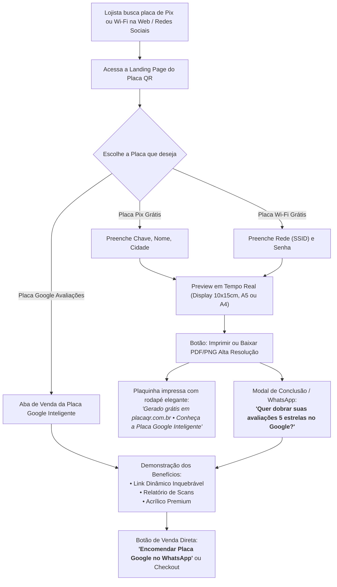

# Planejamento Estratégico e Técnico: Landing Page com Geradores Gratuitos (Pix e Wi-Fi) e Funil de Vendas da Placa Google

## Visão Geral e Estratégia de Negócio

A ideia central proposta é transformar a página inicial pública (`/`) de um simples placeholder em um **motor de atração e aquisição de clientes (Product-Led Growth / Lead Magnet)** de alto impacto.

### 1. Diagnóstico e Análise Crítica da Ideia

> [!TIP]
> **A sua ideia é excelente e altamente lucrativa.** Todo estabelecimento físico (restaurantes, lanchonetes, barbearias, padarias, salões de beleza, clínicas, oficinas, comércio de rua) tem duas necessidades imediatas no balcão:
> 1. Receber pagamentos via **Pix** sem complicação.
> 2. Compartilhar a senha do **Wi-Fi** sem os funcionários precisarem soletrar senhas difíceis.
>
> A maioria desses lojistas usa folhas de papel sulfite rabiscadas à mão ou impressões caseiras feias. Ao oferecer uma ferramenta **gratuita, rápida e com design profissional** para gerar e imprimir essas placas, você atrai exatamente o seu cliente-alvo: **o dono ou gerente do comércio local**.

### 2. Por que a Placa de Avaliação do Google NÃO deve ser gerada gratuitamente?

A decisão de **NÃO permitir a geração/impressão gratuita da Placa do Google** é a chave mestra do modelo de negócio:

| Característica | Placa Pix / Wi-Fi (Gratuita) | Placa de Avaliação Google (Produto Pago) |
| :--- | :--- | :--- |
| **Tipo de QR Code** | **Estático** (o conteúdo nunca muda: chave Pix ou senha do roteador). | **Dinâmico** (aponta para `https://placaqr.pages.dev/r/:code`). |
| **Risco de Quebra de Link** | Praticamente zero (o lojista mantém sua chave e rede). | **Altíssimo se for estático**: links do Google Maps mudam, o Google altera regras de escrita de reviews, ou a empresa muda de perfil. Se o link estático quebrar, a placa vai para o lixo. |
| **Métricas e Relatórios** | Não possui métricas de acesso. | **Painel completo** com contagem de scans, horários de pico, dispositivos e relatório para WhatsApp. |
| **Material e Apelo Visual** | Pode ser impresso em papel pelo lojista para display simples. | **Acrílico espelhado / PVC premium** com corte a laser, design de autoridade e acabamento refinado para atrair olhares. |
| **Papel no Negócio** | **Isca / Atração de tráfego (Lead Magnet)**. | **Core Business (Faturamento e Lucro)**. |

---

## O Funil de Conversão: Como as Placas Gratuitas Vendem a Placa do Google



---

## Melhorias e Inovações Propostas para o Projeto

### 1. No Gerador da Placa Pix (100% Padrão Oficial do Banco Central)
- **Validação EMVCo BR Code Oficial**: Gerar a string padrão do Banco Central com CRC16-CCITT calculado automaticamente (compatível com todos os bancos: Nubank, Itaú, Bradesco, Inter, Santander, BB, Mercado Pago, etc.).
- **Campos inteligentes**:
  - Tipo de Chave (CPF/CNPJ, Telefone com DDI/DDD, E-mail, Chave Aleatória EVP).
  - Nome do Beneficiário (obrigatório pelo BACEN, até 25 caracteres, formatado sem caracteres especiais).
  - Cidade do Beneficiário (obrigatório pelo BACEN, até 15 caracteres).
  - Valor opcional (se vazio, o cliente digita o valor na hora de pagar).
  - Identificador TXID opcional.
- **Botão "Copiar Pix Copia e Cola"** para o usuário testar no app do banco dele antes de imprimir.

### 2. No Gerador da Placa Wi-Fi (Universal)
- **Padrão Oficial de Wi-Fi QR**: `WIFI:T:WPA;S:NomeDaRede;P:MinhaSenha;;`
- Suporte a criptografia WPA/WPA2/WPA3, WEP ou Rede Aberta.
- Opção para **Rede Oculta** (Hidden SSID).
- Opção de exibir ou ocultar a senha por extenso no rodapé da placa (ideal para quem usa laptop e não pode escanear com a câmera).

### 3. Personalização Visual da Placa de Balcão (Preview em Tempo Real)
- **Tamanhos e Formatos Populares de Balcão**:
  - **Porta-retrato / Display de Acrílico T 10x15 cm** (o tamanho mais vendido e usado no Brasil).
  - **Tamanho A5** (metade de uma folha A4).
  - **Folha A4 completa** (para quadros ou displays maiores).
  - **Display tipo "Tenda" (Foldable)**: folha dobrada ao meio que fica em pé sozinha na mesa sem precisar de suporte.
- **Temas e Paletas de Cores**:
  - *Verde Pix Oficial* (com o logotipo oficial do Pix do Banco Central).
  - *Azul Tecnologia* (moderno e profissional).
  - *Dark Premium / Preto e Dourado* (ideal para restaurantes finos, barbearias e hamburguerias).
  - *Minimalista Preto & Branco* (econômico para impressoras monocromáticas).
- **Upload ou Nome do Estabelecimento**:
  - Campo para digitar o nome da loja ou fazer upload do logotipo para estampar no topo da plaquinha.

### 4. A Vitrine da Placa Google (O Produto Principal)
- Na aba ou seção da **Placa do Google**, o visitante encontrará uma apresentação irresistível:
  - **Mockup 3D / Foto da placa física em acrílico espelhado** com o símbolo do Google e as 5 estrelas douradas.
  - **Comparativo: Placa Comum (Papel/Estática) vs Placa Inteligente Placa QR**:
    - Placa comum: se o Google mudar o link, perdeu a placa; sem estatísticas; visual amador que passa pouca credibilidade.
    - Placa Inteligente: link dinâmico atualizado via nuvem sem mexer na placa; painel de métricas de scans diários; acrílico de alta qualidade que incentiva o cliente a deixar 5 estrelas.
  - **Calculadora de Impacto**:
    - "Se você atende 30 clientes por dia e apenas 3 avaliarem sua loja, em 30 dias você ganha **90 avaliações 5 estrelas**, subindo para as primeiras posições do Google Maps na sua cidade!"
  - **Chamada para Ação (CTA)**:
    - Botão destacado em verde WhatsApp: *"Quero minha Placa de Avaliação do Google"*, abrindo conversa no WhatsApp com texto automático já pronto:
      `"Olá! Vi o site e quero encomendar a Placa de Avaliação Inteligente do Google para minha empresa."`

### 5. Impressão Perfeita e Exportação
- Estilos CSS dedicados com `@media print`:
  - Ao clicar em "Imprimir", a página oculta todos os menus, botões e barras laterais, enviando para a impressora **apenas a arte da placa**, com linhas guias de corte pontilhadas para encaixar perfeitamente em displays de 10x15cm ou A5.
- Opção **"Baixar Imagem em Alta Resolução (PNG / PDF)"** com 300 DPI, permitindo que o lojista envie para uma gráfica rápida se preferir.

---

## Arquitetura de Implementação Proposta

### Componentes e Módulos do Frontend (`/web`)

```
web/src/
├── components/
│   ├── landing/
│   │   ├── HeroSection.tsx            # Apresentação e chamada de impacto
│   │   ├── PlateGeneratorTabs.tsx     # Seletor: [Pix] [Wi-Fi] [Google Avaliações ⭐]
│   │   ├── PixForm.tsx                # Formulário para dados do Pix
│   │   ├── WifiForm.tsx               # Formulário para dados do Wi-Fi
│   │   ├── PlatePreview.tsx           # Mockup em tempo real da placa (WYSIWYG)
│   │   ├── GooglePlateShowcase.tsx    # Vitrine e venda da Placa Google
│   │   ├── PrintTemplate.tsx          # Template otimizado para @media print e corte
│   │   ├── ValueCalculator.tsx        # Calculadora de avaliações do Google Maps
│   │   └── LandingFooter.tsx          # Rodapé com selo e acesso ao login admin
│   └── icons/
│       └── PixLogo.tsx                # Vetor SVG oficial do Pix (BACEN)
├── utils/
│   ├── pixPayload.ts                  # Padrão oficial EMVCo BR Code + CRC16
│   └── wifiPayload.ts                 # Padrão universal WIFI:...
└── pages/
    └── Home.tsx                       # Landing Page completa substituindo a atual
```

### Detalhe do Utilitário de Pix (`pixPayload.ts`)
Implementação estrita das especificações do Banco Central:
- Payload Format Indicator (`000201`)
- Merchant Account Information (`26...` com GUI `br.gov.bcb.pix` e Chave)
- Merchant Category Code (`52040000`)
- Transaction Currency (`5303986` - BRL)
- Transaction Amount (se preenchido, `54...`)
- Country Code (`5802BR`)
- Merchant Name (`59...` sanitizado sem acentos, até 25 caracteres)
- Merchant City (`60...` sanitizado, até 15 caracteres)
- Additional Data Field / TXID (`62...`)
- CRC16-CCITT com polinômio `0x1021` (`6304...`)

---

## Perguntas para Alinhamento e Decisões de Design

> [!IMPORTANT]
> Para afinarmos o plano antes da execução:
> 1. **Contato para Vendas da Placa do Google**: Você prefere que o botão "Comprar/Encomendar Placa do Google" direcione para o seu **WhatsApp** (ex: `https://wa.me/55...`) ou que abra um formulário no site? Se for WhatsApp, qual número gostaria de usar como padrão (ou configurável via variável)?
> 2. **Preço / Oferta**: Quer que na aba da Placa do Google apareça um preço de venda sugerido (ex: *"A partir de R$ 79,90 com frete grátis"*) ou prefere deixar apenas *"Consulte valores e condições no WhatsApp"*?
> 3. **Marca d'água na placa gratuita**: Concorda em colocarmos no rodapé da folha impressa de Pix e Wi-Fi uma linha discreta de corte dizendo: *"Arte gerada gratuitamente em placaqr.pages.dev • Peça sua Placa de Avaliações do Google"*? (Isso gera divulgação viral do seu negócio nos balcões dos clientes).

---

## Plano de Fases de Execução

1. **Etapa 1 - Motores de Geração (`pixPayload.ts` e `wifiPayload.ts`)**:
   - Criar algoritmos puros e testados de geração do BR Code Pix e da string universal de Wi-Fi.
2. **Etapa 2 - Componente de Pré-visualização e Impressão (`PlatePreview.tsx` e `@media print`)**:
   - Layouts modernos e atraentes para balcão (estilos Verde Pix, Azul, Dark, Minimalista).
   - Formatação automática em tamanho 10x15cm, A5 e A4 com marcas de corte.
3. **Etapa 3 - Aba e Vitrine da Placa Google (`GooglePlateShowcase.tsx`)**:
   - Demonstração da placa física inteligente com botão direto para WhatsApp/pedido.
4. **Etapa 4 - Integração da Landing Page em `Home.tsx`**:
   - Navegação por abas responsivas, visual mobile-first perfeito e transições suaves.
5. **Etapa 5 - Rastreamento no Google Analytics 4**:
   - Eventos de `generate_pix_plate`, `generate_wifi_plate`, `print_plate`, `click_google_plate_cta`.
6. **Etapa 6 - Testes e Validação**:
   - Testar leitura do QR Pix no app de banco real.
   - Testar leitura do QR Wi-Fi com câmera de celular.
   - Validar layout de impressão no navegador.
